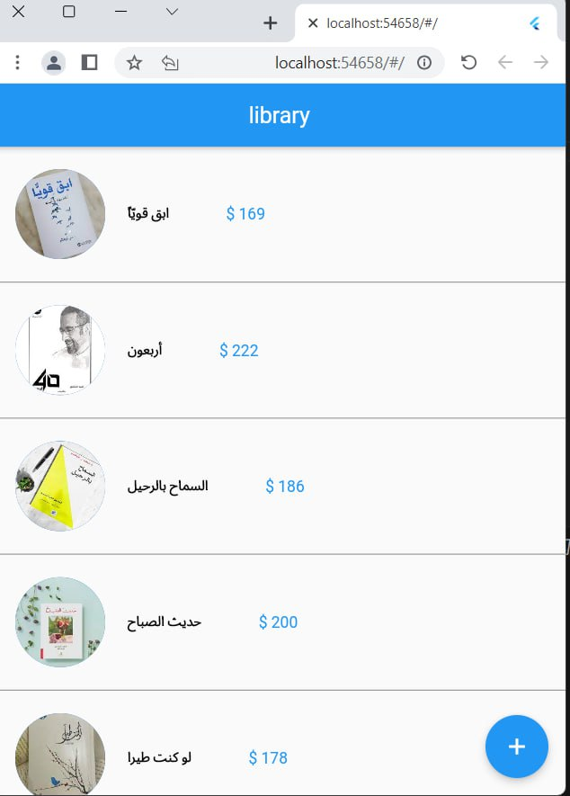
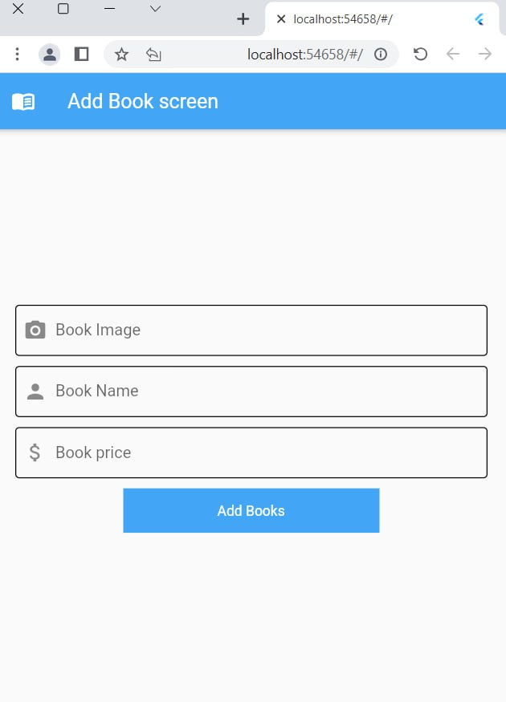

# Library App — تطبيق مكتبة

Library app to manage books and writers: add books (name, image, price, type, publish date) and writers (name, image, birth date), stored in Firestore.

<div dir="rtl">

تطبيق مكتبة لإدارة الكتب والكُتّاب: إضافة كتب (الاسم، الصورة، السعر، النوع، تاريخ النشر) وكُتّاب (الاسم، الصورة، تاريخ الميلاد) مع التخزين في Firestore.

</div>

## Features

- Books list from Firestore (`Books`)
- Add book screen with date picker
- Add writer screen
- Cubit state management

## Screenshots

| Books list | Add book |
|:---:|:---:|
|  |  |

## Tech stack

Flutter, Cloud Firestore, flutter_bloc (Cubit), intl

## Project structure

```
lib/
├── cubit/
│   ├── books_cubit.dart
│   └── books_states.dart
├── firebase_options.dart
├── main.dart
├── models/
│   └── book_model.dart
└── screens/
    ├── add_book_screen.dart
    ├── add_writer_screen.dart
    └── library_screen.dart
```

## Getting started

```bash
git clone https://github.com/aesberali-boop/flutter-library-app.git
cd flutter-library-app
flutter pub get
flutter run -d chrome      # or: flutter run (Android / iOS)
```

The app uses Firebase. The web config lives in [`lib/firebase_options.dart`](lib/firebase_options.dart);
replace it with your own project's config if you fork this repo.


Only the Android, iOS and Web platforms are included. To add desktop support run
`flutter create --platforms=windows,macos,linux .`

## Documentation

- [`docs/report.docx`](docs/report.docx)

## License

[MIT](LICENSE)
